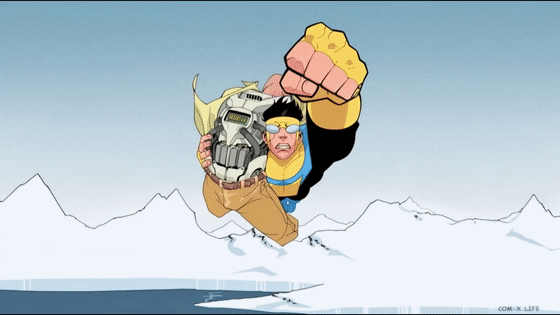

# Comic2Video

**Turn scanned comic pages into a directed, audiovisual story.**

Comic2Video is an experimental pipeline for segmenting comic pages, understanding dialogue and characters, cleaning individual panels, directing short shots, and assembling generated clips into a watchable sequence. It keeps intermediate results inspectable so a bad crop, transcription, restoration, or generation can be traced to its stage.

## Demo

A seven-page run produced 32 clips in reading order. The preview below shows the opening seconds; click it or the full-movie link to watch the 3:38 MP4.

[](demo/Comic2Video_test_data_2.mp4)

[**Watch or download the full movie (MP4)**](demo/Comic2Video_test_data_2.mp4)

The run used 25 MiniMax H3 Lite clips and seven Kling 3 fallback clips. It processed 34 panels across seven pages. The seven rejected H3 Lite shots were regenerated from the same approved frames; no still placeholders are in the final movie. All model inputs, outputs, fallback attempts, corrections, and the final timeline are documented in the run report. Exact spoken dialogue and voice quality still need a listening review.

## Pipeline

1. **Ingest and segment** pages, preserve source coordinates, and establish reading order.
2. **Understand** text, speaker attribution, character identity, and local shot plans.
3. **Clean** isolated panels while preserving scene lettering and original art as much as possible.
4. **Generate** video from reviewed first frames and compatible end frames, with prompt-directed dialogue and sound.
5. **Recover** terminal generation failures through a documented model hierarchy.
6. **Assemble** clips in reading order and keep a traceable timeline.

The current prototype combines an automated panel proposal with visual review and editable corrections. The end-to-end sample required human fixes to geometry, OCR, identities, and cleanup. It demonstrates the working path, not reliable unattended conversion of arbitrary comics.

## Models

- Page understanding and shot planning: `openai/gpt-5.6-terra` through Replicate.
- Panel cleanup: `black-forest-labs/flux-2-dev` through Replicate.
- Default video generation: `minimax/h3-lite` through Replicate.
- First fallback for dialogue shots: `kwaivgi/kling-v3-video`.

The fallback order and each backend's input requirements are in [`docs/video_fallback_hierarchy.md`](docs/video_fallback_hierarchy.md) and [`docs/replicate_generation_guide.md`](docs/replicate_generation_guide.md). Model runs can incur charges. The general offline pipeline does not submit model requests; the separate end-to-end and recovery scripts explicitly do.

## Getting started

Use Python 3.11. Install the pinned dependencies:

```powershell
python -m pip install -r requirements.txt
```

Copy `.env.example` to `.env` and set `REPLICATE_API_TOKEN` only if you intend to run Replicate jobs. Keep `.env` private.

Run the offline ingestion and evaluation path:

```powershell
python run_pipeline.py
python evaluate_pipeline.py
```

For an end-to-end run, place ordered page images in `test_data/<collection>/`, review `config.json` and `e2e_run_config.json`, then run the corresponding pipeline phase. `run_end_to_end.py` assembles cached clips; `recover_failed_videos.py` submits only eligible failed shots and follows the fallback order. Read [`docs/end_to_end_test_data_2.md`](docs/end_to_end_test_data_2.md) before reproducing the sample.

The sample scans and bulky run artifacts are not included. Model weights are not bundled. Add only images you have the right to process and share.

## Project layout

- `comic2video/` — typed data contracts, geometry, extraction, providers, prompts, and resumable jobs.
- `prompts/` — concise stage and backend prompts.
- `docs/` — model interfaces, fallback choices, evaluation notes, and end-to-end receipts.
- `run_*.py` — editable, IDE-friendly pipeline entry points; settings are in Python variables and JSON, not command-line arguments.
- `demo/` — the rendered movie and a lightweight animated preview.

## Limitations

The sample run needed human corrections. Some cleaned frames still have small composition or lettering defects. Audio presence is checked, while exact speech, voice consistency, lip synchronization, and music absence are not yet validated. See the run report for detailed evidence and open issues.
